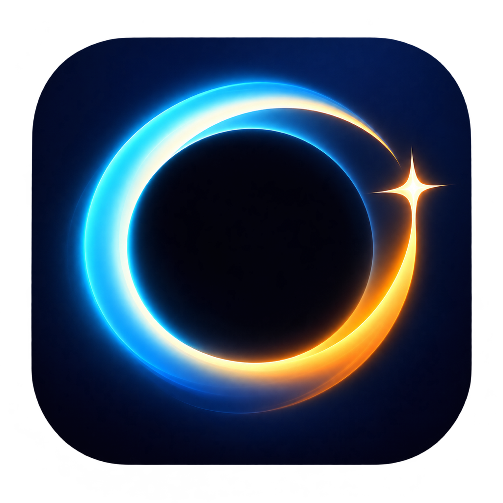
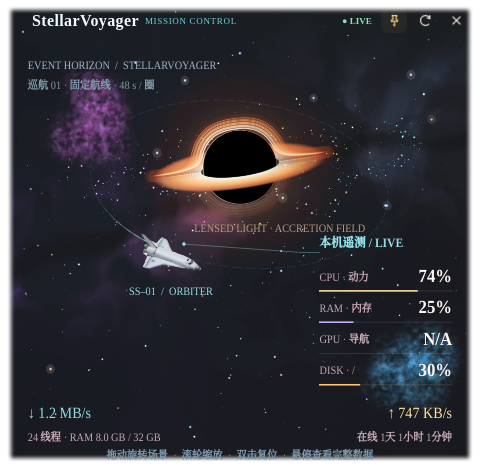

<p align="center">
  
</p>

<h1 align="center">StellarVoyager</h1>

<p align="center"><strong>让你的电脑，成为一艘穿行星海的飞船。</strong></p>

<p align="center"><em>An immersive desktop system monitor that brings real-time telemetry into an interactive 3D universe, featuring a black hole, vibrant nebulae, and an orbiting spacecraft.</em></p>

StellarVoyager 是一款使用 **C++17 · Qt Widgets · OpenGL** 构建的跨平台桌面系统监控应用。它将 CPU、内存、磁盘、网络和可用时的 GPU 数据融入可旋转的三维宇宙：航天飞机沿固定航线巡航，黑洞与环绕星云构成背景，本机运行状态以飞行器遥测的方式呈现。

<p align="center">
  
</p>

<p align="center"><em>新版主界面实拍：圆角窗口、清爽细描边与实时遥测；GPU 不可用时显示 N/A。</em></p>

## 下载 Linux 版

[最新发布版本](https://github.com/Stellarsue/StellarVoyager/releases/latest) · **v1.0.0 / x86_64（amd64）**

> v1.0.0 下载包对应该版本标签；下文新增的跨平台状态面板与平台适配以 `main` 分支源码为准，尚未包含在此 Linux 发布包中。

- [AppImage 便携版](https://github.com/Stellarsue/StellarVoyager/releases/download/v1.0.0/StellarVoyager-1.0.0-x86_64.AppImage)：内置 Qt、中文/英文回退字体及字体解包工具，无需安装 Qt。
- [.deb 安装包](https://github.com/Stellarsue/StellarVoyager/releases/download/v1.0.0/StellarVoyager-1.0.0-linux-amd64.deb)：适合 Ubuntu 22.04 / 24.04，自动安装运行依赖并添加应用菜单入口。
- [SHA256SUMS](https://github.com/Stellarsue/StellarVoyager/releases/download/v1.0.0/SHA256SUMS)：下载文件校验值。

AppImage 运行：

```bash
chmod +x StellarVoyager-1.0.0-x86_64.AppImage
./StellarVoyager-1.0.0-x86_64.AppImage
```

若系统不允许 FUSE 挂载，无需额外开启权限，使用解压运行模式：

```bash
./StellarVoyager-1.0.0-x86_64.AppImage --appimage-extract-and-run
```

安装 `.deb`（请在下载目录运行）：

```bash
sudo apt install ./StellarVoyager-1.0.0-linux-amd64.deb
system-monitor
```

安装后也可在应用菜单搜索 **StellarVoyager**。日常运行无需 root。
下载版需要 Linux x86_64、glibc 2.35+、OpenGL 3.3 和 X11/XWayland；目前不提供 ARM64 构建。
AppImage 默认通过 X11/XWayland 运行，不附带显卡驱动。精简系统若缺少图形运行库，可安装
`libopengl0 libgl1 libegl1 libfontconfig1 libharfbuzz0b`；完整 Ubuntu 桌面通常已有这些依赖。
透明背景依赖桌面合成器，Wayland 下窗口定位和置顶行为可能受合成器限制。

## 特性

- **实时遥测**：CPU 占用与逻辑核心数、内存、根分区磁盘、网络上下行速率、运行时间，以及驱动支持时的 GPU 负载、显存和温度。
- **常驻状态读数**：macOS 菜单栏显示双行网络、风扇、SSD、内存与 CPU 指标；Linux/Windows 托盘菜单和提示文字显示同一组数据。传感器不可读时显示 N/A，不伪造读数。
- **状态栏详情面板**：左键点击 macOS 菜单栏读数或 Linux/Windows 托盘图标，弹出 CPU 曲线、系统磁盘、内存、风扇和网络卡片；窗口会限制在屏幕内，空间不足时可滚动。macOS 右键保留显示主窗口与退出菜单。
- **统一功能菜单**：主窗口和状态详情面板都有齿轮按钮，可打开监控面板或主窗口、立即刷新、切换主窗口置顶、查看关于信息及退出程序；Linux 还可安装可选字体。
- **交互式三维宇宙**：鼠标旋转、缩放和复位；14 组远景星云分布于四周及上下方，不同朝向呈现不同景色。
- **黑洞视觉效果**：物理启发的吸积盘、光子环、透镜光带和明暗变化，与飞船保持前后遮挡关系。
- **真实三维飞行器素材**：基于 NASA/Johnson Space Center 的 Space Shuttle (D) 模型，包含 37,004 个三角形和 11 张表面贴图。
- **固定航线巡航**：每 48 秒完成一圈，机头跟随航线切线，配有细线轨迹和尾迹；隐藏窗口时暂停飞行计时。
- **桌面融合**：无边框、半透明、默认置顶，仅在边缘 10 个逻辑像素内羽化，保留内部场景清晰度。
- **紧凑悬停详情**：278px 宽的半透明圆角遥测卡，保留完整读数；移出、拖动或缩放时自动收起。
- **共享字体安装（Linux）**：可选离线安装 Times New Roman 四种字形，供当前用户的其他桌面程序使用；其他平台使用系统字体回退。
- **本地运行**：读取各系统的本机接口，无需监控服务端。模型与贴图内置于可执行文件；Linux 默认构建还包含可选字体安装包。
- **科技新闻自动发布（Linux，可选）**：通过当前已登录的 Edge 浏览器、ChatGPT 网页和微博网页版，按北京时间 06、09、11、14、17、19、21 点尝试发布一条有来源链接的科技新闻摘要。需要允许浏览器调试连接，详见 [设置说明](automation/README.md)。

## 环境要求

- Linux、macOS 或 Windows 桌面环境，支持 OpenGL 3.3 Core；透明效果需要桌面合成器。
- C++17 编译器、CMake 3.16 或更新版本。
- **Qt 6.2 或更新的 Qt 6 版本**，包含 Widgets、Network、OpenGL、OpenGLWidgets 组件和 JPEG 图像支持。
- Linux 发行版以 Ubuntu 22.04 / GCC 11 / Qt 6.2.4 构建；开发环境另验证过 Ubuntu 24.04 / X11 / Qt 6.9.2，以及 Intel macOS / Qt 6.9.0。
- 干净的 Ubuntu 22.04、24.04 容器使用 Xvfb/Mesa 进行图形启动测试。Windows 代码已按平台隔离但尚未实机验证；Wayland 原生会话的窗口定位、置顶和托盘行为也尚未完整验证。

Ubuntu 上的基础工具、字体回退及可选字体解包依赖：

```bash
sudo apt install build-essential cmake libgl1-mesa-dev \
    qt6-base-dev libqt6opengl6-dev libqt6svg6-dev \
    fonts-liberation2 fonts-noto-cjk fontconfig cabextract desktop-file-utils
```

`cabextract` 可用 `bsdtar` 替代；不使用字体安装功能时可不安装解包工具。

## 编译与运行

```bash
git clone https://github.com/Stellarsue/StellarVoyager.git
cd StellarVoyager

cmake -S . -B build -DCMAKE_BUILD_TYPE=Release
cmake --build build -j2
./build/system-monitor
```

以上为 Linux/macOS 使用单配置生成器时的运行命令。Windows 使用 Visual Studio 等多配置生成器时，程序通常位于 `build/Release/system-monitor.exe`；具体路径以构建输出为准。macOS 菜单栏空间不足时，新状态项可能被系统隐藏，需要腾出菜单栏空间。

### macOS 安装到“应用程序”

在 macOS 上先构建，再生成可从 Finder 打开的 `.app`；打包脚本会加入应用图标、Qt 框架和 Cocoa 插件，并进行本机临时签名：

```bash
bash tools/package_macos.sh build/system-monitor build/StellarVoyager.app
ditto build/StellarVoyager.app /Applications/StellarVoyager.app
open /Applications/StellarVoyager.app
```

打包脚本不会覆盖已有的 `build/StellarVoyager.app`；重新打包时请指定新的输出路径，或先自行备份旧包。该签名只适合本机安装，分发到其他 Mac 需要正式签名和公证。

如果使用独立 Qt SDK，配置时可增加 `-DCMAKE_PREFIX_PATH=/path/to/Qt/gcc_64`，将路径替换为实际 SDK 目录。直接运行源码构建的程序需要匹配的 Qt 动态库与平台插件；Linux 用户若不想自行配置依赖，可下载上面的 AppImage。

为兼容已有桌面安装，暂时保留 `system-monitor` 可执行文件名、`linux-system-monitor.desktop` 桌面文件名，以及 `STELLARSUE_` 开头的构建选项和资源路径。

## 安装到当前用户（Linux）

```bash
cmake --install build --prefix "$HOME/.local"
update-desktop-database "$HOME/.local/share/applications"
```

确保 `~/.local/bin` 已加入桌面会话的 `PATH`，否则需将安装后的桌面文件中 `Exec` 和 `TryExec` 改为可执行文件的绝对路径。桌面应用列表显示 **StellarVoyager**。

需要系统级安装时可运行 `sudo cmake --install build`；应用日常运行和用户字体安装不需要 root。

### 开机自动启动

先完成用户级安装，再复制桌面启动项：

```bash
mkdir -p "$HOME/.config/autostart"
cp "$HOME/.local/share/applications/linux-system-monitor.desktop" \
   "$HOME/.config/autostart/linux-system-monitor.desktop"
```

如果应用不在桌面会话的 `PATH` 中，同样需要修改 autostart 文件的 `Exec` 和 `TryExec`。

## 操作方式

| 操作 | 效果 |
| --- | --- |
| 拖动星空 | 旋转三维视角，探索不同方向的星云 |
| 滚动鼠标滚轮 | 缩放场景 |
| 双击星空 | 复位视角与缩放 |
| 悬停星空 | 查看完整系统遥测 |
| 拖动顶部控制条 | 移动窗口 |
| 图钉 / 刷新按钮 | 切换置顶 / 立即采样 |
| 主窗口或详情面板的齿轮按钮 | 打开功能菜单，包括“退出程序” |
| 关闭按钮 | 有托盘时隐藏窗口；无托盘时退出 |
| 左键点击菜单栏读数 / 托盘图标 | 打开或关闭五卡片系统详情面板 |
| macOS 右键菜单栏读数 / Linux、Windows 托盘菜单 | 显示主窗口或退出；Linux 另提供共享字体安装 |

默认窗口约为 480 × 470；水平旋转连续 360°，俯仰范围约为 ±69°。

## 字体（Linux）

Linux 上英文和数字优先使用 **Times New Roman**，缺失时回退到 **Liberation Serif**；中文使用 **Noto Serif CJK SC**。macOS 与 Windows 不提供共享字体安装功能，使用系统可用字体回退。

默认构建携带完整、未经修改的微软历史 Core Fonts for the Web 原始安装包及 EULA，**不是从 Windows 系统复制的新版字体，也不单独重新分发 TTF**。

- 首次启动且字体缺失时显示许可；同意后离线解压常规、粗体、斜体、粗斜体四种字形。
- 可从托盘菜单再次安装。暂不接受许可不会影响应用使用回退字体。
- 仅解压原始包，不执行 Windows EXE；校验 SHA-256、保留许可并刷新字体缓存。
- 默认安装到 `~/.local/share/fonts/stellarsue-times`；设置 `XDG_DATA_HOME` 时使用其下的 `fonts/stellarsue-times`。
- 不修改其他程序的默认字体。其他桌面程序重启后可选择使用；沙箱应用能否读取字体取决于权限。

阅读并接受 [原始许可](assets/corefonts/EULA.html) 后，可通过命令行安装：

```bash
./build/system-monitor --install-fonts --accept-font-license
```

不携带此字体包的构建方式：

```bash
cmake -S . -B build -DSTELLARSUE_BUNDLE_TIMES=OFF
cmake --build build -j2
```

**重要：该字体许可禁止为营利目的分发，包括随收费产品分发。** 关闭字体包不代表其他代码或素材自动获得商业授权。完整来源和校验值见 [字体来源说明](assets/corefonts/SOURCE.md)。

## 数据来源与边界

- Linux 的 CPU、内存、网络和运行时间来自 `/proc`；macOS 使用 Mach/sysctl，Windows 使用系统 API。系统磁盘容量通过 Qt `QStorageInfo` 获取。
- Linux 尝试读取 hwmon 风扇转速；Intel macOS 对 AppleSMC 作只读查询。Apple Silicon 和 Windows 不保证可读取风扇，失败时显示 N/A。
- GPU 优先查询 `nvidia-smi`，否则尝试 DRM/sysfs。具体指标取决于驱动暴露的接口；不可用的负载显示 N/A，不伪造数据。
- 网络速率是非 `lo` 网卡的累计字节差分，不是网络测速。
- 黑洞渲染是**物理启发的视觉近似**，不是广义相对论光线追踪；飞船巡航是艺术化固定路径，不是航天动力学模拟。
- 支持 Mesa 软件渲染，但相较 GPU 硬件渲染可能消耗更多 CPU。建议启用硬件加速。

## 测试与开发

```bash
cmake -S . -B build -DSTELLARSUE_BUILD_SMOKE_TESTS=ON
cmake --build build -j2

# 需要可用的 X11 桌面与 OpenGL 上下文，不能使用 offscreen 平台
QT_QPA_PLATFORM=xcb ./build/stellarsue-smoke build/previews

# 隔离的临时用户目录，不修改真实用户字体；需启用内置字体包
QT_QPA_PLATFORM=offscreen ./build/stellarsue-font-test
```

测试覆盖模型及贴图加载、固定航线连续性、相机旋转、星云分布与裁剪、隐藏/恢复计时、10px 边缘透明度、悬停卡片、遥测映射、OpenGL 资源重建、字体回退、许可拒绝、离线安装及已有文件保护。

主要代码位置：

- `systeminfo.*`：本机系统数据采集。
- `monitorwidget.*`：主窗口、控制条和系统托盘。
- `statusdashboard.*`：菜单栏或托盘点击后显示的跨平台详情面板。
- `starmapwidget.*`、`blackholewidget.*`：宇宙场景、黑洞和遥测绘制。
- `nebulaenvironment.*`、`flightpath.*`、`spacecraftmesh.*`：星云分布、巡航路径和模型加载。
- `telemetrytooltip.*`、`themefonts.h`、`fontbundle.*`：主题提示卡、字体选择和安装。
- `assets/nasa-shuttle/`：原始模型、转换后的几何与贴图。

一般编译无需 Python。仅在重新生成航天飞机模型时，才需要 Python、NumPy 和 `DracoPy==2.2.0`，然后在项目根目录运行 `python tools/prepare_shuttle.py`。该脚本会重新生成模型及贴图，请先保存自己的素材改动。

## 许可与致谢

项目源代码目前尚未指定开源许可证；公开仓库本身不等于授予任意再分发或商业使用权限。如需相关授权，请联系维护者。

- **NASA/Johnson Space Center**：[Space Shuttle (D)](https://science.nasa.gov/3d-resources/space-shuttle-d/) 模型。遵循 [NASA 媒体与品牌使用指南](https://www.nasa.gov/nasa-brand-center/images-and-media/)，不代表 NASA 背书。转换与装配说明见 [素材来源](assets/nasa-shuttle/SOURCE.md)。
- **Microsoft Core Fonts for the Web**：原始完整安装包及 [EULA](assets/corefonts/EULA.html)，另见 [来源和分发限制](assets/corefonts/SOURCE.md)。
- **Qt**：应用框架与 OpenGL 集成；使用和分发时须遵守所采用 Qt 版本的许可。

Linux 发行包的第三方说明、LGPL 动态库替换方式和对应源码见 [打包许可说明](packaging/THIRD_PARTY.md)。Release 中的 `runtime-sources.tar.xz` 是运行库对应源码，不是运行应用所必需的下载。
构建打包流程见 [Linux 打包指南](packaging/README.md)。

早期 Kenney 模型与飞行器概念图保留在素材目录，当前不嵌入应用。Kenney 素材附带独立的 [CC0 许可](assets/kenney-space-kit/License.txt)。
